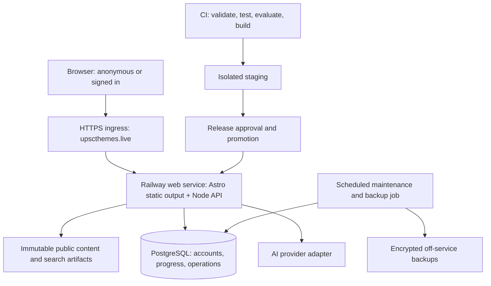
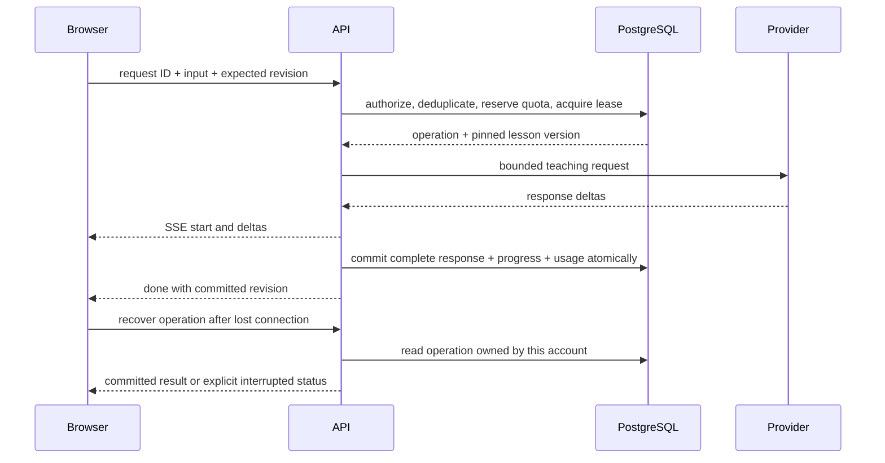

# Flagship release architecture — proposed

Status: design for review; no runtime implementation or infrastructure changes.
Baseline: repository commit `0d60a6d`, UX audit and Railway pilot examined on 2026-11-07.

The release should help a learner start, understand, practise and resume with predictable behavior. The proposal retains Astro, the existing content and URLs, the Node tutor, and the educational rubric. It introduces shared account progress, a complete versioned Stage 0 curriculum, and explicit operational controls.

**Confirmed product constraints (2026-11-07).** `https://upscthemes.live` is the only public application address, with `/api` on the same origin. Launch for an initial audience of 100 learners, monitor actual use, and expand after marketing begins. Models author the curriculum; the proposed quality gate uses a different model for independent review. There is no mandatory human subject-review step. Complete all 253 subject placements before declaring Stage 0 complete.

**Architecture proposals.** Retain Astro and Node in one Railway web service; use PostgreSQL for durable learner records; make authored lessons readable without an account and require accounts for saved AI interactions. Keep content generation/review outside learner requests. Budget and model selection remain to be set; this design does not authorize paid batch generation or change production infrastructure.

**Relationship to the existing design documents.**

| Existing document | Design carried forward | Flagship extension or deliberate change |
|---|---|---|
| [Interaction prototype](stage0-prototype.md) | Four subjects, stable placement IDs, free-form follow-ups, optional checks, focus mode and mobile learning | Replace demonstration responses/local prototype statuses with published lessons and account-backed evidence; put concept selection earlier |
| [Teaching and assessment rubric](stage0-teaching-rubric.md) | Meaning, distinction and application; accept informal language; no grammar penalties; no compulsory 30-day gate; verified sources/PYQs; every applicable output-review dimension must score 2 | Apply the same rubric to all 253 placements through recorded independent model reviews; require three application scenarios rather than the existing minimum of two |
| [Backend and deployment design](stage0-backend.md) | Secure sessions, recovery, ownership, CSRF, streaming, idempotency, quotas, real-provider evaluations and persistent storage | Select its same-origin deployment option at the confirmed public domain; propose PostgreSQL, durable operation leases, cost accounting and rehearsed recovery |

These documents remain the record of the prototype and deployed pilot. The teaching rubric continues to define educational behavior. Once approved, this architecture supersedes the pilot's split-domain deployment option and SQLite storage choice for the flagship; it does not imply those migrations have happened. Never label model-reviewed content as human-reviewed, or test fixtures as real-output quality evidence.

**Current implementation and implications.**

| Existing source | Retain | Change |
|---|---|---|
| `src/layouts/Base.astro`, `src/components/stage0/Styles.astro` | Astro layouts, Figtree, themes, focus styles | Shared UI tokens and components; consistent navigation and state treatments |
| `src/pages/`, `src/lib/data.ts`, generated content | Stable theme/question/syllabus/map URLs and relationships | Task-oriented entry pages, real theme filters, complete search |
| `src/lib/stage0/curriculum.ts` | 253 placement IDs, 248 distinct labels | Catalogue becomes the common reference for lessons, publishing and progress |
| `backend/lessons.mjs`, `previews.ts` | Existing teaching material as migration input | Replace preview dependencies and slug-keyed criteria with placement-keyed versioned lessons |
| `backend/app.mjs` | Ownership, CSRF, origin checks, idempotent operations | Split route handling from domain services and persistence; eliminate direct SQL in handlers |
| `backend/store.mjs`, `schema.sql` | Transactional invariants and receipt-based recovery | PostgreSQL repository implementation and explicit migrations |
| `api.ts`, `live-conversation.ts`, `live-progress.ts` | Cross-tab privacy protection, streaming parser, draft preservation | Explicit client states, retry actions, shared contracts and server progress |
| `backend/provider.mjs` | Provider boundary and output validation | Content/version attribution, cancellation semantics, budget accounting and monitoring |
| `backend/evaluate.mjs`, teaching rubric | Real-output review approach | Per-placement regression suites and recorded release decisions |
| Dockerfile, workflows, deployment notes | Reproducible image and health checks | Staging, migration checks, browser tests, restore drills and promotion gates |

The pilot has three live placements per subject. Some existing lesson records explicitly say real-model output review is pending. Existing live status must not be imported as evidence of editorial approval.

**UX priorities and evidence.** Complexity is relative implementation effort, not a delivery estimate. P0 blocks the flagship; P1 is required for the intended learning experience.

| Priority | Observed problem and evidence | Proposed change and learner benefit | Complexity |
|---|---|---|---|
| P0 | Daily submission writes `checked`, then `persist()` replaces it without that field (`src/pages/daily/index.astro`) | Preserve submitted state across reload; learners can trust completed work | Small |
| P0 | Map lab grid styling overrides hidden workspace state; a rejected base-data promise remains cached (`src/pages/maps/lab.astro`) | Honor hidden state and reset failed requests; make the initial screen and Retry predictable | Small |
| P0 | Map feature selection is pointer-oriented; some tab/answer states lack the correct semantics; audited colors miss normal-text contrast | Keyboard alternatives, semantic selection, tested contrast and visible focus; make core tasks operable | Medium |
| P0 | Progress loading can render an empty result before success; separate browser/account stores disagree | Explicit pending/error states first, then shared persisted progress; avoid implying lost work | Medium–large |
| P1 | Only 12 of 253 placements are live while progress uses the full catalogue | Publish all reviewed lessons from one manifest and report availability separately from progress | Large |
| P1 | Stage 0 is absent from primary navigation; mobile introductory content pushes subject choice far below the fold | Learn navigation and immediate subject/resume actions; reduce steps to useful learning | Medium |
| P1 | Themes use a wide static table; search omits several learning resources | Filterable lists and grouped search with direct destination links; support finding and returning | Medium |
| P1 | Lesson/login controls and feedback vary; password requirements are not visible beside inputs | Shared controls, readable inputs, inline requirements and consistent state feedback | Medium |

The code and browser audit establish these behaviors, not their population-wide impact. The proposed navigation labels, anonymous explanation before signup, preferred lesson length and value of cross-feature progress remain product hypotheses. Validate with first-time learners completing find-a-concept, explain/check, find-a-question and resume tasks; observe confusion, completion and return behavior during the 100-learner launch. Do not describe those hypotheses as user research findings.

**Deployment topology.**



Use one modular application, one PostgreSQL service and a scheduled maintenance/backup job. Start with one web replica until deployment and load tests pass; a second replica is an operational decision, not a claim of database high availability. No Redis, vector database, microservices or separate search cluster is required for this catalogue. PostgreSQL is justified by shared progress, transactional coordination and independent database operations; 253 lessons alone do not require it. SQLite remains a viable limited pilot, but its current single-volume constraints are unsuitable for the proposed replication path.

Keep web and database in the same region, selected after measuring latency from India and confirming available regions/cost. Private database networking; no public database port by default. PostgreSQL on Railway still needs an explicit operator-owned backup, restore and upgrade plan. Do not assume that a database template provides managed failover or point-in-time recovery. [Railway PostgreSQL documentation](https://docs.railway.com/databases/postgresql)

Serve public HTML with revalidation, fingerprinted assets with immutable caching, and all account/API responses with `no-store`. Never cache session responses or AI streams. Static content must remain usable when the database/provider is unavailable. Use separate liveness, dependency-readiness and tutor-capability endpoints: a configured key is not proof of provider health. Provider outages disable tutor calls without making public learning pages unhealthy.

**Application boundaries and proposed directory layout.**

```text
content/stage0/catalogue.json             placement registry, aliases, relationships
content/stage0/lessons/<subject>/<slug>.json
content/stage0/reviews/                   content and evaluation approval records
src/components/ui/                       shared controls, fields, notices, dialogs
src/components/learning/                 lesson, conversation, check, progress UI
src/lib/client/                          request state and typed API clients
shared/contracts/                        request/response schemas and content types
backend/modules/{auth,curriculum,learning,practice,usage}/
backend/infra/{postgres,provider,logging}/
backend/migrations/                      ordered, explicit SQL migrations
tools/content/                           validation, public/private compilation, coverage
tests/{integration,browser,accessibility,load}/
```

This is a gradual extraction, not a framework rewrite. Convert new/changed backend modules to checked TypeScript while preserving Node runtime behavior. Keep thin HTTP handlers, domain services enforcing invariants, and repositories owning SQL. Shared runtime schemas validate requests and responses; TypeScript alone cannot validate network data. Keep current endpoints through a compatibility adapter while introducing `/api/v1`; remove the adapter only after old browser clients have a documented expiry path.

**Information architecture and frontend behavior.**

Primary navigation: Today, Learn, Questions, Themes, Maps. Learn contains Foundations (Stage 0) and Roadmap; Questions contains Prelims and Mains. Existing URLs continue to work, with consistent breadcrumbs and active parent navigation. Search and learning-account access remain available throughout. Secondary links expose syllabus, reading sources and About.

The landing page prioritizes one next action and a few clear alternatives. Foundations starts with a short purpose statement, available subjects/lessons and a resume link. Explanation of the method and optional pacing guidance remain available below. All concepts retain their separate subject meaning, including shared names in Polity and IR. No mandatory 30-day wait or requirement to finish all concepts before structured study.

Lesson order: objective, concise authored explanation, example, common confusion, sources, then optional conversation and check. Reading is anonymous. Account creation is prompted at the point of saving or using AI. A guest sees useful content rather than a disabled empty chat. A completed check offers a clear next concept or revisit action. Keep the three-part evidence model and describe the result as demonstrated understanding in that check, not permanent mastery or exam readiness.

Build a shared client state model: `loading | empty | ready | saving | saved | offline | error | limited`. Conversation state additionally includes `sending | streaming | interrupted | recovering`. An unavailable progress request must never appear as zero progress. Show errors next to the affected task, provide executable Retry, retain drafts, and announce status changes without moving focus unexpectedly. Clear private UI immediately on account changes. Make counters, home summaries and detailed pages use the same progress contract.

Use Figtree, a shared primary action color, semantic feedback colors, 16–18px reading text, 16px inputs, readable secondary labels, a small spacing scale, and shared button/dialog/field implementations. Prefer lists and dividers for catalogues. Remove decoration that displaces the next task. Support keyboard map exploration, semantic answer selection, text alternatives for map information, optional untimed practice, 320px reflow, visible focus and reduced motion. Freehand drawing has different accessibility constraints from selecting a feature; provide paper-based practice and a readable self-check alongside it.

**Search and content discovery.**

Compile a versioned, type-grouped search index from the same catalogue build: concepts, themes, Mains, Prelims, maps and syllabus. Include canonical URLs, aliases and short snippets; exclude private data and assessor answers. Begin with a small manifest and lazily fetched index shards, with a measured transfer budget. Support short known terms such as IR, GDP and UN through aliases. Preserve filters/query in the URL, provide direct question links, and restore browsing position. A server-side search service becomes justified only if measured index size or latency exceeds the budget.

**Complete Stage 0 as a content system.**

| Subject | Placements | Current live | Additional live lessons required |
|---|---:|---:|---:|
| Polity | 68 | 3 | 65 |
| Economics | 60 | 3 | 57 |
| Geography | 65 | 3 | 62 |
| International Relations | 60 | 3 | 57 |
| Total | 253 | 12 | 241 |

The companion `stage0-content-coverage.csv` enumerates every placement. It records present availability, not completed authorship. All 253 require the flagship review gate, including the existing twelve.

Each lesson contract must contain:

- Stable placement ID, schema version, immutable lesson version/content hash, subject meaning, objective, aliases and prerequisite explanations.
- Minimum accurate central idea; a short plain-language explanation; a familiar example; an alternate explanation; a misconception and correction; limits of analogies.
- Explicit distinction from similarly named concepts, especially shared cross-subject labels.
- Meaning, distinction and application checks, acceptable evidence anchors, unacceptable misconceptions, and at least three independently reviewed application scenarios. Track scenario exposure and rotate without claiming an unlimited unseen question pool.
- Specific authoritative sources with locator/excerpt references, verification date, and qualification of changing or contested claims. Relevant PYQ/syllabus links only where verified; absence is allowed.
- Actual author/reviewer model identifiers, provider run IDs, review decision, execution date, prompt version, source-artifact hashes and referenced evaluation results. Record model aliases and resolved versions when available. No generated reviewer identities or fabricated review dates.

The public artifact contains the lesson explanation, examples, sources and relationships. The private server artifact contains assessment answer anchors and review metadata that should not appear in client bundles. Build both from a validated source and scan public output for private fields. Retain historical lesson versions for conversations and assessment interpretation.

Publication lifecycle: `draft → content-reviewed → model-evaluated → approved → published`; `suspended` can disable AI or retire misleading content without deleting learner history. An immutable release manifest enumerates the exact approved versions. Every transition has evidence; CI rejects incomplete records. Frontend availability, backend capability and progress denominators derive from this same manifest, replacing the separate `featured` allowlist. Runtime emergency flags may reduce availability without silently changing lesson versions.

Author the complete catalogue in subject/category batches. The first calibration batch spans all four subjects and includes ambiguous terms. Stabilize the schema and rubric before bulk authoring. Translation is a separate evaluated content dimension; do not promise validated multilingual teaching based on model capability alone.

The model-led publishing pipeline is separate from the runtime tutor:

1. A source collector retrieves authoritative material for each placement and records URL, locator, retrieval date and content hash. Deterministic checks verify retrieval and quoted-text matches; a model checks whether the passage supports the claim. A working URL alone is insufficient evidence. Retrieved text is treated as data, never as instructions. Prefer stable primary educational/institutional sources; retain permitted excerpts and provenance rather than redistributing entire source works.
2. Author model A produces the structured lesson, evidence anchors, misconceptions and scenarios against that source packet and the existing rubric. Model knowledge helps draft familiar concepts; external evidence checks central claims and qualifications, including context-dependent uses in Polity and IR.
3. Reviewer model B, distinct from A, receives the lesson and source packet without the author's self-rating or rationale. It checks accuracy, subject meaning, source support, teaching clarity and assessment integrity. It also independently labels evaluation answers, with supporting evidence. Store actual review outputs and identities; a second prompt to A must not be reported as a different-model review.
4. On disagreement, revise against cited evidence and rerun review. A separately configured adjudicator can resolve remaining disagreements using the sources; disagreement cannot be resolved merely by majority vote. Bound revision to three cycles initially. Unresolved placements remain unpublished with explicit reasons and can be retried with better sources or a different reviewer. No mandatory human review queue is introduced.
5. Run the real tutor/assessment evaluations below using pinned artifacts. Publish only when deterministic checks and every applicable rubric dimension pass. The release manifest records content and evaluation evidence, with no manual fabrication of approvals.

Model agreement does not establish factual truth: models can share errors. Source checks, independent answer construction, deliberately flawed calibration examples and regression cases provide additional evidence. Report quality as model-reviewed, including unresolved limitations. Routine published lessons require one tutor call per interaction; authoring/review/adjudication costs are offline release costs. Keep separate batch budgets, bounded concurrency, resumable per-placement receipts and incremental reruns keyed by content/source/prompt/model hashes. Exact models are selected after the calibration batch measures accuracy, latency and cost.

Completion means 253 approved authored lessons, 253 working tutoring/check flows, source verification, semantic review and repeatable regression evidence. It does not mean that every term simply opens an unrestricted chatbot.

**Evaluation requirements.**

Per placement, test explanation, follow-up confusion, a misconception, ambiguous or out-of-scope input, and fresh application. Run each applicable teaching case at least twice, following the existing rubric. For each assessment dimension include adjudicated correct, partial, incorrect, informal-language and instruction-manipulation answers. Missing or skipped evidence must not become failure or mastery. Assert both structured validity and semantic judgement. Independent model review against the sources and rubric decides the content gate. Keep reviewer-generated reference answers separate from the tutor's own outputs; unresolved reference labels cannot count as a passing test. Include source-grounded deliberate factual errors and unsupported understanding awards to test the reviewer itself. Model-adjudicated reference labels must never be described as human ground truth.

Pin results to placement, lesson version, prompt, model identifier and evaluation-suite version. Content/model/prompt changes trigger affected evaluations. Block release on material factual errors, unsupported understanding awards or fabricated references. Report agreement and false-positive rates with denominators; do not invent a quality score before measurements exist. Evaluation spending has its own explicit run cap and is separate from learner quotas. The existing rubric requires all applicable dimensions to pass; preserve that gate.

**Learner data and storage.**

| Entity | Responsibilities and constraints |
|---|---|
| users, sessions | Existing username/password/recovery behavior; hashed tokens; expiry and revocation; user-scoped access |
| content_releases, lesson_versions | Imported manifest/version metadata and immutable server lesson reference |
| conversations, messages | User + placement ownership; optimistic revision; lesson-version attribution; ordered committed messages |
| assessment_attempts, assessment_answers | Explicit attempt ID, pinned lesson version, scenario IDs, evidence, feedback and independent dimensions |
| concept_progress, bookmarks | Derived latest-check summary plus independent revisit flag; no client-written understanding status |
| practice_attempts, practice_answers | User, immutable question-set version, submitted state, server-recomputed score, unique client attempt ID |
| roadmap_progress, map_attempts | User-scoped completion and explicitly self-reported map scores; stable theme/map identifiers |
| operations, usage_ledger, quota_buckets | Idempotency, leased execution, cancellation, conservative reservations and reconciliation |
| import_receipts, maintenance_jobs | Repeat-safe local-data import and operational work |

Use foreign keys, uniqueness constraints and transactions. Store UTC timestamps; calculate daily allowance/set boundaries using Asia/Kolkata consistently. Keep domain records explicit rather than merging every activity into an untyped progress blob. Index by user and updated time for resume; paginate history and exports. Account deletion cascades owned records and cancels pending work. Redact operational diagnostics and define backup-retention behavior in the privacy notice.

Default proposal: signed-in progress syncs across features; anonymous practice remains local. Offer an explicit preview-and-confirm import after sign-in. Validate IDs and set versions, recompute quiz scores, preserve separate attempts, and never convert prototype statuses into assessed learning. Imports have a unique receipt, are safe to retry, and never overwrite newer account records. Guest/prototype data shared on a device is not automatically attributed to the next signed-in account. Clear only successfully imported local entries after confirmation.

Reading resume and durable history are separate from model context. The current store deletes messages beyond 60: remove silent history truncation, keep a documented retention policy, and limit only the context sent to the model. Summarization is optional later and must not silently substitute for the learner's own assessment evidence.

**API and operation protocol.**

Proposed `/api/v1` resources: session/auth; catalogue and capability manifest; conversation retrieval; streamed chat; assessment start/answer/draft; bookmarks; practice attempts/submission; roadmap progress; map attempts; resume summary; import; account export/deletion; operation status/cancel. API errors carry stable code, user-safe message, request ID, retryability and retry time when relevant. Success payloads return revisions, content version and usage. GET operations never create learning progress.

Chat/check request includes client request ID, placement ID and expected revision; the server selects instructions, model and lesson version. A short PostgreSQL transaction creates missing quota rows, locks relevant rows in deterministic order, checks limits and revisions, inserts the unique operation and reserves usage. Release all locks before calling the provider. PostgreSQL row locks support this coordination; deadlock/serialization retries are bounded and occur before provider dispatch. [PostgreSQL locking documentation](https://www.postgresql.org/docs/current/explicit-locking.html)



Operation states: `reserved → running → completed | failed | cancelled | indeterminate`. Store lease owner, expiry, fencing generation, heartbeat, cancellation time, request fingerprint and version identifiers. Enforce one active expensive operation per account initially, plus a global concurrency cap. Completion must verify active lease, session validity, revision and uncancelled status before committing. Logout/reset/delete must invalidate applicable operations in the database; process-local abort controllers alone are insufficient across replicas.

For v1, stream execution belongs to the serving process. On browser disconnect, request cancellation; if the committed result already exists, recover it by operation ID. On process loss, a lease reaper marks unresolved work indeterminate, retains its cost reservation and releases the active lock after fencing the old worker. Never automatically reissue a paid provider call whose outcome is uncertain. The user can explicitly start a new attempt. Application commits are idempotent; provider-side execution is not promised exactly once. No background queue is needed until independent, resumable generation is a measured requirement.

Store lesson/prompt/model versions and provider usage with each operation. Maintain user call/token limits, global call/token budgets and a hard configured spend ceiling using a versioned operator-maintained price table and conservative reservation. Alert before limits, fail closed on unknown model pricing, reconcile actual usage once, and show learners the binding limit and reset time. Hosting cost and other consumers of the provider account remain outside that application ledger. Do not increase the existing 500-call global allowance merely because the catalogue is larger.

For 100 initial learners, the current 500-call daily global ceiling permits an average of five calls each if everyone is active, despite the separate 30-call per-user cap. Thirty calls for every learner would require 3,000 calls/day; this is an upper-bound scenario, not a demand forecast. Measure calls and tokens per completed learning journey during calibration, then set an explicit launch allowance within the chosen budget. Display that individual allowances are also subject to shared availability. Monitor first-week daily active learners, completed journeys and cap hits before changing limits.

**Authentication, safety and data handling.**

Retain HttpOnly Secure host cookies, same-origin requests, CSRF and exact Origin validation, recovery-code rotation and server-owned histories. Make password rules visible and accessible; support password managers. Use a trusted ingress configuration before relying on forwarded IPs. The present zero-hop setup may place many learners into a shared proxy-IP allowance; verify actual ingress behavior and add account/concurrency protection rather than blindly trusting arbitrary headers.

Enforce payload/token/context limits, request timeouts and provider circuit breaking. Serve tutor text safely; keep model instructions and assessment anchors server-owned. Treat learner text/news quotations as untrusted content. No current-news retrieval is required for the foundations release; explicitly distinguish dated supplied facts from hypothetical examples. A later retrieval capability requires its own sourcing and evaluation design.

Use a CSP compatible with the generated frontend, escape rendered content, avoid private analytics payloads, and keep secrets out of builds/public variables. Log request IDs, timings and error codes rather than prompts, answers, cookies or keys. Define retention for chats, receipts, drafts, analytics and backups before launch; export must cover all account data promised by the product. Restore procedures must reapply deletions made after a backup using a restricted deletion journal retained through the recovery window.

**Migration and release operations.**

1. Fix audited P0 defects on the existing stack and capture regression tests before structural changes.
2. Introduce typed domain/repository boundaries and versioned content compiler while SQLite still serves the pilot.
3. Provision isolated staging PostgreSQL; test production-like data volumes using synthetic records and a sanitized schema.
4. Rehearse SQLite export/import. Preserve IDs, password/recovery hashes, records, revisions, timestamps and pinned legacy assessment snapshots. Check row counts, foreign keys, sampled hashes and exports. Do not reconstruct historical evidence from new lesson content.
5. During a declared write pause, drain/fence provider operations, make a consistent SQLite backup, import and verify PostgreSQL, then switch the application. Require fresh login at cutover; preserve accounts and recovery ability. Keep the original database read-only.
6. After accepting writes in PostgreSQL, roll back compatible application images against PostgreSQL. Returning to the old SQLite snapshot would lose new writes; it requires a deliberate reconciliation migration, not a configuration toggle.
7. Move the public domain only after route parity, canonical links, authentication, analytics configuration and health checks pass. Retire the preview as the primary site. Host-only Railway sessions do not transfer to the custom domain; explain the sign-in requirement. Device-only data on the old origin needs an explicit export/import route, not automatic cross-origin access.

Promote immutable images built by CI through staging to production. Use backward-compatible expand/migrate/contract database changes, with one migration runner and an advisory lock. Stage secrets, budgets and databases must be isolated. Keep a previous compatible image and content release available. Test graceful shutdown with active streams. Serve the designed HTML 404 page for missing frontend routes rather than the current API JSON fallback.

Backups need a documented schedule, encryption, off-service copies and successful restoration into an isolated database. Target RPO <= 1 hour and RTO <= 4 hours initially; these are acceptance targets, not current capabilities. Validate the chosen backup method and plan against these targets. Railway's documented volume backup schedule alone must not be assumed to meet them. [Railway backup documentation](https://docs.railway.com/volumes/backups)

If using hourly logical backups, measure completion time and restore duration at expected size; monitor the age of the last recoverable copy, not just job start time. Adopt verified WAL/PITR tooling or a managed database with those capabilities if the target cannot be demonstrated. Keep volume snapshots as an additional recovery layer. Rehearse restore, data deletion, deployment failure and provider outage before launch and periodically thereafter.

**Performance, capacity and monitoring.**

The confirmed launch audience is 100 learners; this does not mean 100 daily active or concurrent users. Start with one web replica and one database. Proposed stress-test profile: a burst of 100 concurrent public readers, 20 active authenticated learners and 10 concurrent tutor streams, subject to the configured provider concurrency/budget limit. Test excess stream demand for clear limited responses as well as accepted-request latency. These are benchmark inputs, not attendance forecasts or capacity promises. Load test slow provider responses, bursts, database pool limits, cancellation and recovery. Bound connection pools across all replicas and jobs; reserve operational headroom. Review actual use after launch and before marketing-driven expansion; scale only when measurements justify it.

Initial acceptance targets: public LCP <= 2.5s, INP <= 200ms and CLS <= 0.1 at the 75th percentile on agreed mobile/network conditions; internal non-AI API p95 <= 500ms under the agreed load. Tutor UI must acknowledge the action immediately and show meaningful pending state; separately measure provider first-token/completion latency rather than promise a number before evaluation. Propose 99.5% monthly core-service availability initially; evaluate its cost and distinguish provider capability from site availability.

Monitor HTTP latency/errors, DB connections/locks, expired leases, failed recoveries, AI latency/failure/invalid feedback, quota exhaustion, estimated/actual cost and backup freshness. Alert on sustained core errors, unavailable DB, missing backups, spend thresholds and unbounded pending operations. A designated owner needs runbooks for account recovery support, content suspension, provider disablement and restoration.

Product analytics should measure time to first useful action, task completion, search failures and return-to-learning, without collecting raw questions/answers. Keep educational quality review separate from engagement metrics; more messages do not prove more learning.

**Implementation sequence and acceptance.**

| Package | Scope | Dependencies | Completion evidence |
|---|---|---|---|
| A: reliability/accessibility | Quiz persistence, hidden lab state, retry behavior, contrast, keyboard map/answer controls, honest loading states | None | Reproduced audit failures now pass; keyboard and narrow-screen checks |
| B: content foundation | Placement-keyed schema, public/private compiler, release manifest, reviewed calibration batch | A can run independently | 253-entry coverage report; no private assessment fields in public output; calibrated review rubric |
| C: persistence/contracts | PostgreSQL repositories, migrations, operation leases, usage ledger, account-wide progress | Stable contracts; B versions | Concurrent ownership/idempotency/quota tests; migration/restore rehearsal |
| D: UX implementation | Shared design system, entry flows, navigation, search, lesson/check layouts, browser-state handling | B + API contracts; A | End-to-end journeys on mobile/desktop; accessible forms; all previous URLs resolve |
| E: curriculum completion | Remaining 241 lessons plus review of original 12, sources, scenarios and live evaluations | B; calibrated model pipeline and batch budget | All 253 pass publication gates with recorded decisions |
| F: flagship promotion | Domain cutover, content release, backups, monitoring, load tests and rollback rehearsal | A–E | Production checklist signed off; bounded real-provider smoke checks; restore evidence |

No timeline is asserted until the calibration batch establishes model-pipeline throughput, revision rate and cost. Content work can proceed alongside infrastructure work after the schema is stable. Internal releases can be staged by subject, but the public claim of complete Stage 0 requires the full acceptance gate.

**Required verification.** Preserve existing ownership/CSRF/recovery/quota tests; add PostgreSQL race tests across separate processes, lease expiry and late completion, cancellation after logout, duplicate submissions, daily-boundary behavior, immutable assessment versions, local-import replay and migration reconciliation. Browser suites cover anonymous reading, signup/recovery, stream interruption, complete checks, resume on another device, progress failures, filters/search and all audited defects. Accessibility checks combine automation with keyboard and screen-reader review; mobile Safari/Android keyboard behavior must be tested on real devices. Content CI validates all 253 IDs, source metadata, scenario completeness, manifest integrity and public/private separation. Production smoke tests use bounded calls and identifiable disposable test accounts with cleanup.

**Remaining implementation inputs.** Monthly infrastructure/runtime AI budget, one-time content-generation/evaluation budget, available author/reviewer models, and supported launch languages. These do not prevent review of the architecture. Proposed defaults are English evaluated UI/content first, optional learner-requested language support clearly qualified until evaluated, and account progress across all existing activities. The public host, 100-learner initial audience and model-led content production are confirmed and need not be reconfirmed. Nothing in this document constitutes completed content review, measured SLO attainment or implemented production infrastructure.
